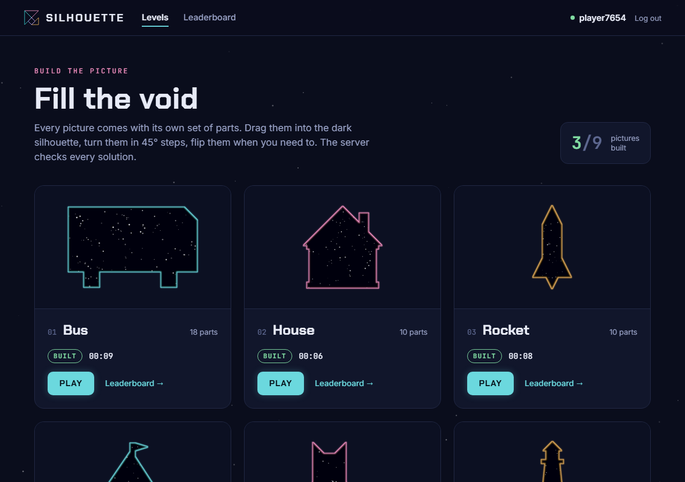
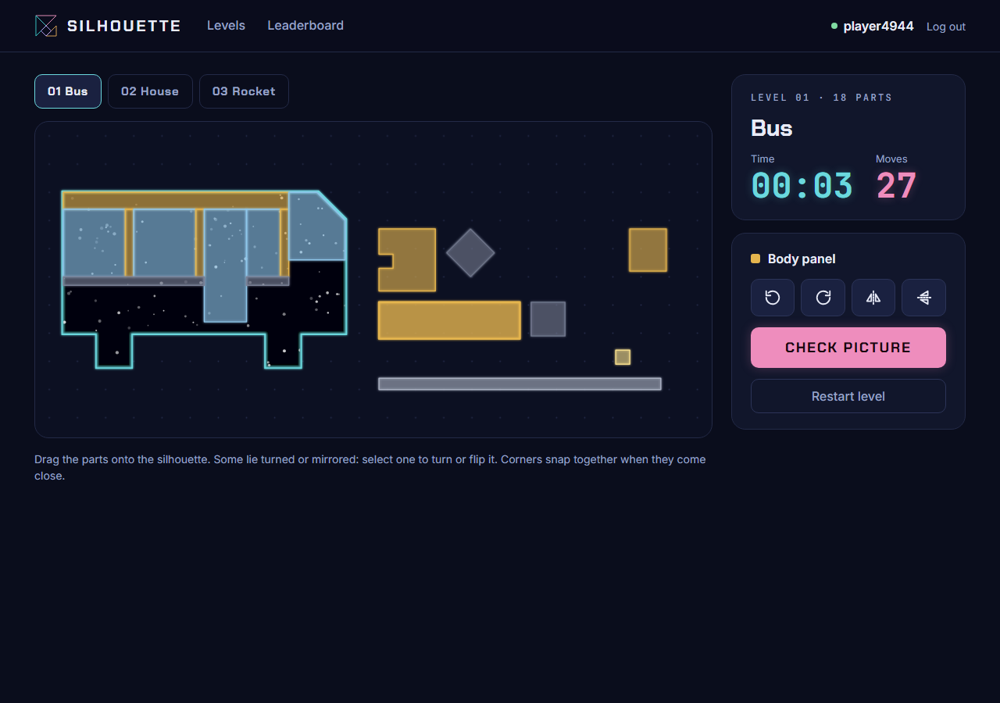
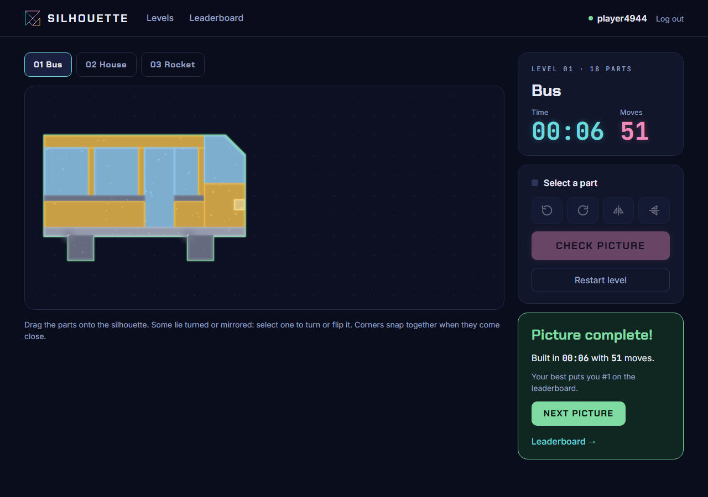
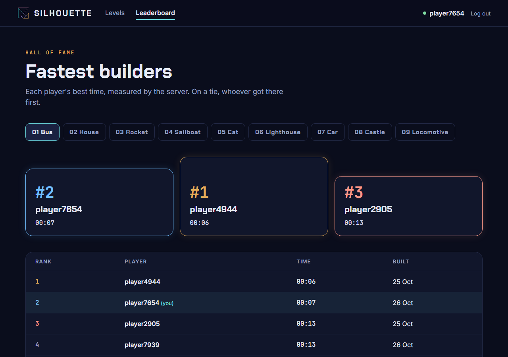

# Silhouette Puzzle

A picture-building puzzle game in the browser. Every level is a picture,
from a sailboat to a steam locomotive, cut into its own parts; the player
drags, turns and flips the parts until they fill the picture's dark
silhouette. The server does all the geometry and keeps the time, so a record
on the leaderboard cannot be faked from the browser.

| Choosing a picture | Building the bus |
|---|---|
|  |  |
| **Picture complete** | **Leaderboard** |
|  |  |

## Features

- **Nine pictures with their own parts**: a bus, a house, a rocket, a
  sailboat, a cat, a lighthouse, a car, a castle and a locomotive, from 9 to
  18 parts each, every part in the natural colour of the real thing.
- **Playing** by dragging parts onto the silhouette, turning them in 45°
  steps and mirroring them left to right or top to bottom; corners snap
  together when they come close. Some parts start turned or mirrored.
- **One page for every picture**: switching pictures, going on to the next
  one or starting over happens in place, without reloading the page, while
  every picture keeps its own address and the back button works.
- **Checking on the server**: the parts are placed and united with JTS, and
  a picture counts when gaps, overhangs and overlaps stay within 1% of the
  silhouette.
- **Records** for logged-in players: the server times every attempt, keeps
  each player's best per picture and ranks players by time. Guests can play
  everything, without a place on the leaderboard.
- **Accounts**: registration and login with a form, sessions, BCrypt.

## Tech stack

Java 21 · Spring Boot 4 (Web MVC, Security, Validation) · MongoDB 7 ·
Spring Data MongoDB · Liquibase · JTS Topology Suite · Thymeleaf · React 19 ·
TypeScript · Vite · SVG · JUnit 5 · Vitest · Testcontainers · Playwright ·
Checkstyle · GitHub Actions · Docker

## Getting started

The only prerequisite is Docker:

```bash
docker compose up --build
```

Open http://localhost:8080 and start with any picture. To run against your
own MongoDB instead, start it on `localhost:27017` and run
`./mvnw spring-boot:run`.

| Variable / property       | Default                                       | Purpose                                     |
|---------------------------|-----------------------------------------------|---------------------------------------------|
| `MONGODB_URI`             | `mongodb://localhost:27017/silhouette-puzzle` | MongoDB connection string                   |
| `app.solution.tolerance`  | `0.01`                                        | how far a picture may be off, as a share of the silhouette |
| `app.attempts.lifetime`   | `24h`                                         | how long a timed attempt can be checked     |

## Architecture

One Spring Boot application serves everything: the pages, rendered on the
server with Thymeleaf, and a small JSON API for the game.

The game is one page whose layout never changes: tabs, board, panel. Only
the picture on it does. So it is a React application in TypeScript, mounted
into that page: moving to another picture, to the next one after a win, or
starting over loads just the new level and, for a logged-in player, a new
timed attempt from the API, and redraws the board in place, without
reloading the page. The address follows along, so every picture keeps its
own link and the browser's back button works. The game's markup and its
behaviour live together in components, and everything on the page follows
from one state. The levels, leaderboard and login pages stay server-rendered
HTML.

### Server: `src/main/java`

```
config/      game beans (geometry, clock) and the Liquibase runner
security/    Spring Security setup and the logged-in player
entity/      Level, Piece, Player, Attempt
dto/         what crosses the boundary: SubmitRequest, SubmitResult, RegisterForm
repository/  Spring Data repositories
service/     levels, players and their results, attempts and checking
controller/  the pages and the game's JSON API
geometry/    the puzzle geometry on JTS, free of Spring
```

### Browser: [`src/main/frontend`](src/main/frontend)

```
types.ts      the level and the check, mirroring the Java records
geometry.ts   the board's geometry: poses, the tray layout, snapping
api.ts        the check request, with the CSRF token
void.ts       the starry silhouettes with a glowing edge
levels.ts     the levels page: draws its sky and silhouettes
game/
  main.tsx    reads the opening level from the page and mounts the game
  state.ts    every rule of play as a pure reducer
  Game.tsx    loading levels and attempts, the address, the clock, the check
  Tabs.tsx    the level tabs, links that open a level in place
  Board.tsx   the SVG board: dragging, the silhouette, snap flashes
  Piece.tsx   one part, memoised so a drag redraws only that part
  Panels.tsx  level and meters, the tools, the verdict
```

The game page opens with what the game needs, in data attributes: the level
in the address, the level tabs and, for a logged-in player, a timed attempt
the server starts as it renders the page. From there the game talks to the
API:

| Call                               | For                                                    |
|------------------------------------|--------------------------------------------------------|
| `GET /api/levels/{id}`             | another level: silhouette, parts, colour, the next level; never the solution |
| `POST /api/levels/{id}/attempts`   | a new timed attempt, for a logged-in player            |
| `POST /api/levels/{id}/check`      | the verdict on the placement of every part and, for a solved timed attempt, the server-measured time and the player's place |

All state lives in one reducer (`game/state.ts`): the level, parts,
selection, drag, moves and the last verdict, so the rules of play are tested
without a browser. Every start of a level counts as a new round, and an
answer that arrives after the player has moved on is dropped.

### Build

The frontend is part of the Maven build, so `./mvnw package` and the Docker
image need no Node installed: the
[frontend-maven-plugin](https://github.com/eirslett/frontend-maven-plugin)
fetches Node 24 into `target/node`, then runs `npm ci`, type-checks with
`tsc`, and Vite writes `js/game.js` and `js/levels.js` into the jar's static
resources. Vitest runs in Maven's `test` phase, next to JUnit.

To work on the frontend (with Node 24 installed), run the server with
`./mvnw spring-boot:run` and, in `src/main/frontend`, `npm run watch`: Vite
rebuilds the scripts into `target/classes/static` on every change, and a page
reload picks them up.

### Levels

Levels live in
[`src/main/resources/levels/pictures.json`](src/main/resources/levels/pictures.json)
as finished pictures: every part drawn where it belongs, with its name,
colour, how it lies in the tray at the start, and whether it is handed out
mirrored. On startup the server derives each part's shape around its centre,
the reference solution, and the silhouette as the union of the placed parts,
rejecting overlaps and holes. Every level is therefore solvable by
construction.

## Data model

```
levels    { _id, name, number, silhouette, pieces: [{ name, color, outline, startRotation }], solution }
players   { _id, username, usernameKey, passwordHash, createdAt,
            bests: [{ _id, levelId, startedAt, solvedAt, timeMs }] }
attempts  { _id, levelId, playerId, startedAt, solvedAt, timeMs }
```

A player's best on a picture is simply their best solved attempt. Open
attempts have their own collection only to hold the start time, and a TTL
index removes them two days after they start. The best attempt per picture
is embedded in the player: it is read together with the player, the array is
bounded by the number of pictures, and a leaderboard is one aggregation over
the players who have the picture (`$match` on an index of `bests.levelId`,
`$unwind`, `$sort`).

Indexes and every change to the shape of stored data are versioned with
**Liquibase** in [`db/changelog`](src/main/resources/db/changelog): change
sets with checksums, a lock for instances starting together, and data
migrations such as moving results out of attempts into the players. Spring
Boot's Liquibase support needs JDBC, so a small runner applies the changelog
to MongoDB on startup.

## Security

What a request can change, and what guards it:

| Request                 | Changes                          | Guarded by                                              |
|-------------------------|----------------------------------|---------------------------------------------------------|
| Registration form       | creates a player                 | validation, unique name regardless of case, BCrypt, CSRF |
| Login, logout           | the session                      | Spring Security, CSRF                                   |
| Opening a game page or starting a picture in it | a temporary attempt, logged-in players only | checkable for a day, removed after two; CSRF |
| Checking a picture      | **the player's best time**       | time measured on the server; the attempt must be the player's own, open and not expired; it counts once; geometry checked with JTS |

The game counts moves too, but only for the player: the server cannot
verify them, so they are never sent and never ranked. Both changes that
matter are conditional updates in MongoDB: an attempt is marked solved only
while it is still open, and a best is added only while missing and replaced
only by a better attempt.

## Testing & CI

- **Unit tests** cover the geometry (placing, checking, building
  silhouettes, every rotation and invalid shape) and the level catalog.
- **Frontend tests** (Vitest) cover the board's geometry and the rules of
  play in the game's reducer: dragging, snapping, turning, flipping, moves
  and every verdict.
- **Integration tests** run against MongoDB in Testcontainers: the game's
  API (levels without their solutions, attempts for players only, the check), the pages, registration, results and leaderboards,
  concurrent submissions of one attempt and concurrent bests of one player,
  and the Liquibase changelog on a database holding data in an older shape.
- **Browser tests** (Playwright, [`e2e/`](e2e)) build pictures by dragging,
  turning and flipping parts as a player would, move between pictures, back
  and forth, without the page reloading, and go through registration and
  login, errors included. They drive the application as
  `docker compose` runs it, so the executable jar and the image are covered
  too; every test registers its own players.

```bash
./mvnw verify                          # unit, frontend and integration tests
docker compose up -d --build           # the app on port 8080
cd e2e && npm ci && npx playwright install chromium
npx playwright test                    # browser tests
npm run screenshots                    # the screenshots in this README
```

GitHub Actions runs the Maven build with all its tests on every push, then
starts the image with `docker compose` and runs the browser tests against it.

## License

[MIT](LICENSE)
