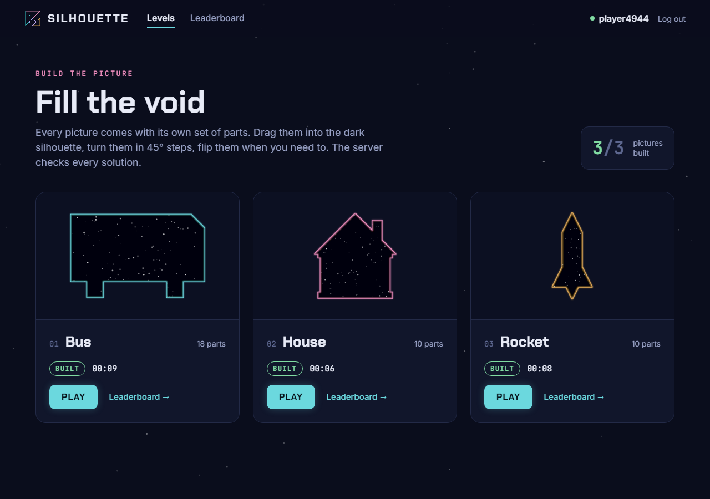
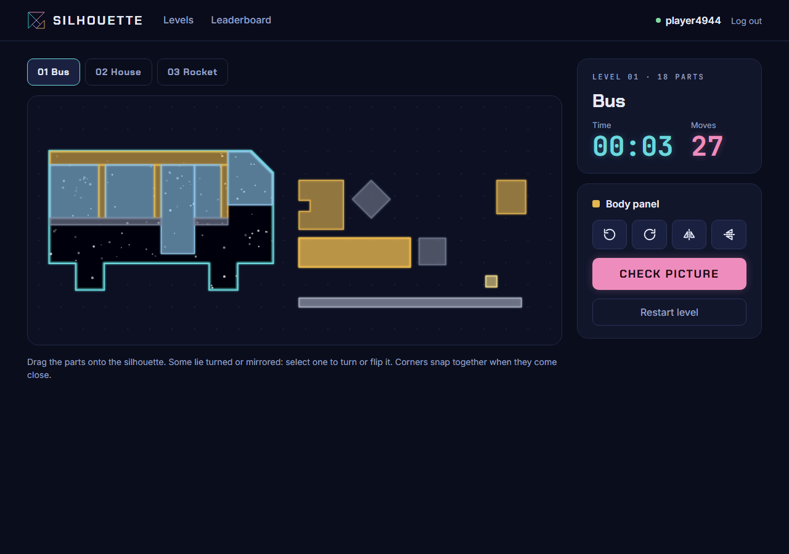
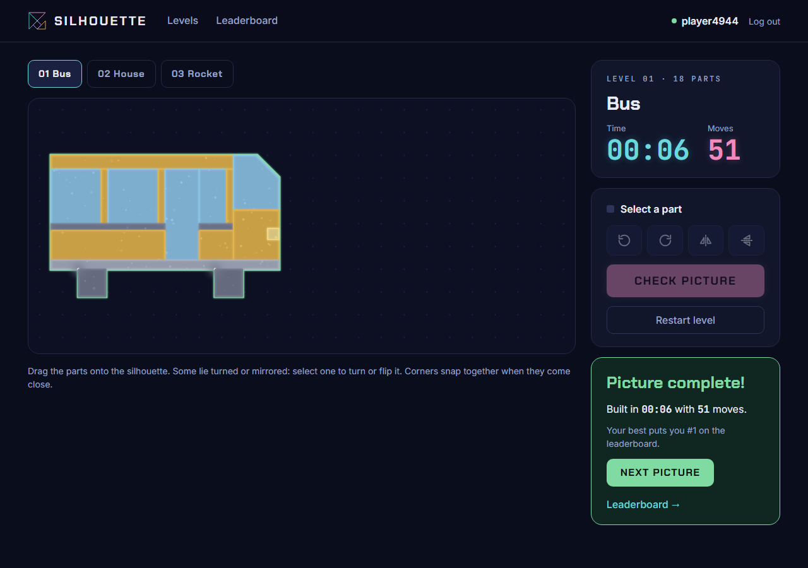
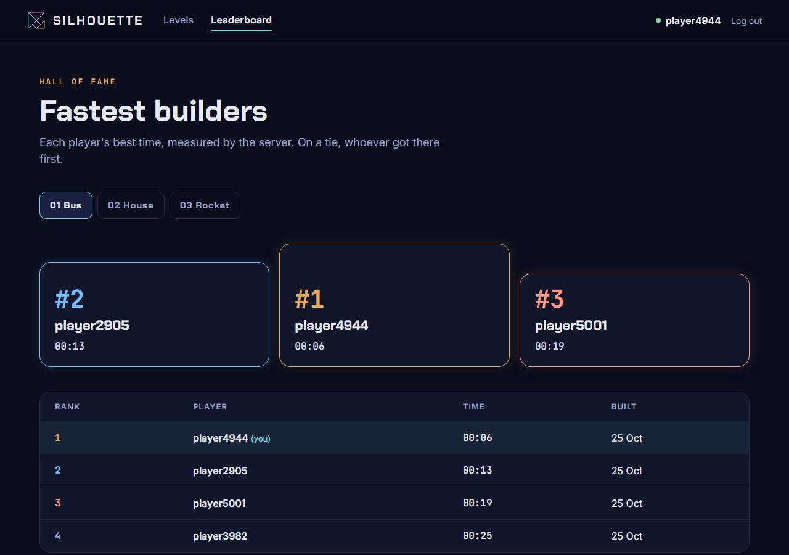

# Silhouette Puzzle

A picture-building puzzle game in the browser. Every level is a picture, a
bus, a house or a rocket, cut into its own parts; the player drags, turns and
flips the parts until they fill the picture's dark silhouette. The server
does all the geometry and keeps the time, so a record on the leaderboard
cannot be faked from the browser.

| Choosing a picture | Building the bus |
|---|---|
|  |  |
| **Picture complete** | **Leaderboard** |
|  |  |

## Features

- **Pictures with their own parts**: 18 for the bus, 10 each for the house
  and the rocket, each part in the natural colour of the real thing.
- **Playing** by dragging parts onto the silhouette, turning them in 45°
  steps and mirroring them left to right or top to bottom; corners snap
  together when they come close. Some parts start turned or mirrored.
- **Checking on the server**: the parts are placed and united with JTS, and
  a picture counts when gaps, overhangs and overlaps stay within 1% of the
  silhouette.
- **Records** for logged-in players: the server times every attempt, keeps
  each player's best per picture and ranks players by time. Guests can play
  everything, without a place on the leaderboard.
- **Accounts**: registration and login with a form, sessions, BCrypt.

## Tech stack

Java 21 · Spring Boot 4 (Web MVC, Security, Validation) · MongoDB 7 ·
Spring Data MongoDB · Liquibase · JTS Topology Suite · Thymeleaf · SVG and
vanilla JavaScript · JUnit 5 · Testcontainers · Playwright · Checkstyle ·
GitHub Actions · Docker

## Getting started

The only prerequisite is Docker:

```bash
docker compose up --build
```

Open http://localhost:8080 and start with any picture. To run against your
own MongoDB instead, start it on `localhost:27017` and run
`./mvnw spring-boot:run`.

| Variable / property       | Default                                       | Purpose                                     |
|---------------------------|-----------------------------------------------|---------------------------------------------|
| `MONGODB_URI`             | `mongodb://localhost:27017/silhouette-puzzle` | MongoDB connection string                   |
| `app.solution.tolerance`  | `0.01`                                        | how far a picture may be off, as a share of the silhouette |
| `app.attempts.lifetime`   | `24h`                                         | how long a timed attempt can be checked     |

## Architecture

```
config/      game beans (geometry, clock) and the Liquibase runner
security/    Spring Security setup and the logged-in player
entity/      Level, Piece, Player, Attempt
dto/         what crosses the boundary: SubmitRequest, SubmitResult, RegisterForm
repository/  Spring Data repositories
service/     levels, players and their results, attempts and checking
controller/  the pages and the one JSON endpoint
geometry/    the puzzle geometry on JTS, free of Spring
```

Every page is rendered on the server with Thymeleaf. The only script is the
game board, an SVG with no build step. Its page carries just what it needs:
the silhouette and the parts of the level, never the reference solution, and
for a logged-in player the id of a timed attempt the server starts as it
renders the page. The board makes a single call, `POST /api/levels/{id}/check`,
with the placement of every part, and gets back the verdict and, for a solved
timed attempt, the server-measured time and the player's place.

### Levels

Levels live in
[`src/main/resources/levels/pictures.json`](src/main/resources/levels/pictures.json)
as finished pictures: every part drawn where it belongs, with its name,
colour, how it lies in the tray at the start, and whether it is handed out
mirrored. On startup the server derives each part's shape around its centre,
the reference solution, and the silhouette as the union of the placed parts,
rejecting overlaps and holes. Every level is therefore solvable by
construction.

## Data model

```
levels    { _id, name, number, silhouette, pieces: [{ name, color, outline, startRotation }], solution }
players   { _id, username, usernameKey, passwordHash, createdAt,
            bests: [{ _id, levelId, startedAt, solvedAt, timeMs }] }
attempts  { _id, levelId, playerId, startedAt, solvedAt, timeMs }
```

A player's best on a picture is simply their best solved attempt. Open
attempts have their own collection only to hold the start time, and a TTL
index removes them two days after they start. The best attempt per picture
is embedded in the player: it is read together with the player, the array is
bounded by the number of pictures, and a leaderboard is one aggregation over
the players who have the picture (`$match` on an index of `bests.levelId`,
`$unwind`, `$sort`).

Indexes and every change to the shape of stored data are versioned with
**Liquibase** in [`db/changelog`](src/main/resources/db/changelog): change
sets with checksums, a lock for instances starting together, and data
migrations such as moving results out of attempts into the players. Spring
Boot's Liquibase support needs JDBC, so a small runner applies the changelog
to MongoDB on startup.

## Security

What a request can change, and what guards it:

| Request                 | Changes                          | Guarded by                                              |
|-------------------------|----------------------------------|---------------------------------------------------------|
| Registration form       | creates a player                 | validation, unique name regardless of case, BCrypt, CSRF |
| Login, logout           | the session                      | Spring Security, CSRF                                   |
| Opening a game page     | a temporary attempt, logged-in players only | checkable for a day, removed after two       |
| Checking a picture      | **the player's best time**       | time measured on the server; the attempt must be the player's own, open and not expired; it counts once; geometry checked with JTS |

The game counts moves too, but only for the player: the server cannot
verify them, so they are never sent and never ranked. Both changes that
matter are conditional updates in MongoDB: an attempt is marked solved only
while it is still open, and a best is added only while missing and replaced
only by a better attempt.

## Testing & CI

- **Unit tests** cover the geometry (placing, checking, building
  silhouettes, every rotation and invalid shape) and the level catalog.
- **Integration tests** run against MongoDB in Testcontainers: the picture
  check over HTTP, the pages, registration, results and leaderboards,
  concurrent submissions of one attempt and concurrent bests of one player,
  and the Liquibase changelog on a database holding data in an older shape.
- **Browser tests** (Playwright, [`e2e/`](e2e)) build pictures by dragging,
  turning and flipping parts as a player would, and go through registration
  and login, errors included. They drive the application as
  `docker compose` runs it, so the executable jar and the image are covered
  too; every test registers its own players.

```bash
./mvnw verify                          # unit and integration tests
docker compose up -d --build           # the app on port 8080
cd e2e && npm ci && npx playwright install chromium
npx playwright test                    # browser tests
npm run screenshots                    # the screenshots in this README
```

GitHub Actions runs both suites on every push.

## License

[MIT](LICENSE)
